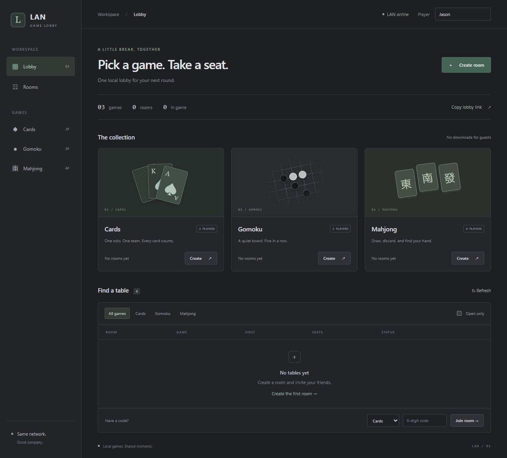

# LAN · 局域网游戏大厅

把斗地主、五子棋和麻将集中到一个简约深色游戏大厅。**一次启动、一个地址、一个端口**，同一局域网的朋友打开浏览器即可一起玩。

界面和提示使用简短英文，配色接近 IDEA Darcula。大厅支持统一昵称、房间列表、游戏筛选、创建房间、按房间号加入及继续原来的牌局。无需登录、数据库、安装依赖或前端构建。



## 启动

1. 主机安装 [Node.js](https://nodejs.org/)，要求 **18.2 或更高版本**，建议使用当前 LTS。
2. 克隆或下载本仓库，进入项目目录：

   ```sh
   git clone https://github.com/gjf1202/lan_gaming_platform.git
   cd lan_gaming_platform
   npm start
   ```

   Windows 也可以双击 `Start LAN.cmd`。
3. 主机打开 `http://localhost:3000`。服务窗口会同时显示可供其他人访问的 `LAN` 地址。
4. 游戏期间保持主机和服务运行，按 `Ctrl+C` 停止。停止会清空内存中的房间和牌局。

不需要运行三套原游戏服务，不需要 `npm install`。如果 3000 端口已被占用，在 PowerShell 中改用其他端口：

```powershell
$env:PORT=3010
npm start
```

## 其他人如何加入

1. 所有人连接同一 Wi-Fi 或能够互通的局域网。
2. 主机点击大厅的 **Copy lobby link**，把链接分享给朋友。例如 `http://192.168.1.8:3000`。普通 HTTP 下若浏览器无法复制，提示中会显示地址，可手动复制浏览器地址栏中的局域网地址。
3. 每个人在大厅右上角 **Player** 填写昵称（1–12 个字符）。主机首次打开时建议也使用该局域网地址，让分享链接和游戏记录保持一致。
4. 点击游戏卡片的 **Create**，或通过 **Create room** 选择游戏创建房间。
5. 其他人在 **Find a table** 中找到该房间，点击 **Join**。也可在底部选择游戏、输入六位房间号，点击 **Join room**。
6. 房间里的每个人点击 **Ready**，然后由房主点击 **Start**。斗地主需要 3 人、五子棋 2 人、麻将 4 人。

只有主机需要 Node.js；加入者只需要浏览器。Windows 防火墙询问时允许 Node.js 在专用网络通信，并确认所选端口允许局域网访问。**别人在自己的电脑上不能使用主机的 `localhost` 地址。**

房间列表约每 3 秒更新，也可点击 **Refresh**。房间号按游戏区分，手动加入时务必选对游戏。满员或正在进行的房间显示状态，不能以新玩家身份加入。练习房间不出现在大厅列表中。

## 大厅与牌局切换

- 游戏页顶部的 **LAN / Lobby** 返回大厅，也可点击游戏名称切换。
- 返回大厅不会主动退出座位；同一浏览器可通过 **Continue your room** 回到原房间。断开游戏页后座位通常保留两分钟，超时会释放；切换期间仍可能轮到你，斗地主计时也会继续。
- 同一种游戏已有房间时，大厅创建或加入另一房间会询问是否退出原房间；中途退出可能取消原牌局。取消则保留原座位。
- 如需立即退出，在游戏页点击 **Leave**。刷新可恢复未过期的会话。
- 昵称由三个游戏共用，会话按游戏隔离。同一游戏的多个标签页会共用同一座位；测试多人对局请用不同浏览器、独立浏览器资料或不同设备。
- 浏览器需要允许本站存储来保存会话。localhost、局域网 IP、不同端口各自保存独立记录。

## 玩法

### 斗地主 · Cards

- 3 人、54 张牌，每人 17 张，剩下 3 张底牌。轮流叫分，最高叫分者获得底牌，成为地主；另两人为农民队。
- 地主先出。按牌型和点数压过上家，或点击 **Pass**；连续两家不要后，最后出牌者重新领出。单击牌选择或取消，点击 **Play** 出牌。
- 支持单张、对子、三张、三带一/对、顺子、连对、飞机及其带牌、四带二、炸弹、王炸等常见牌型。先出完手牌的一方获胜。
- 有 **Hint**、倒计时与超时自动操作、音效、**Alerts** 提醒和记牌器。也可在游戏入口选择 **Practice** 与机器人练习。只记游戏内分数。

### 五子棋 · Gomoku

- 2 人，在 15×15 棋盘轮流落子，黑先白后。横、竖、斜任一方向连续 5 子或更多获胜；棋盘满则和棋。
- 使用自由规则，不设禁手。支持对手同意后悔棋，以及双方同意后再来一局。

### 麻将 · Mahjong

- 4 人、136 张基础牌：万、筒、条各 1–9，加东南西北、中发白，每种 4 张，无花牌。
- 庄家 14 张先打，其余人 13 张，之后轮流摸打。轮到自己时点击手牌打出；可响应时点击 **Chi / Pong / Kong / Hu / Pass**。
- 胡牌为四组顺子或刻子加一对将，支持自摸、点炮；吃只能由下家提出，胡优先于杠碰吃。杠后补牌。
- 所有有响应选项的玩家都需选择，才继续结算。牌墙摸空则流局，结束后四人点击 **Next hand** 开始下一局。
- 使用基础规则，不含七对、番种计分、花牌和一炮多响。

## 提醒与音效

- 斗地主保留 **Sound / Alerts** 开关和记牌器。浏览器通常需要先点击页面，才能播放音效；检查浏览器标签页和系统是否静音。
- 麻将页右上角 **Alerts** 开启出牌及吃碰杠胡提醒，默认关闭。设置会保存，英文提示保持简短。
- 局域网普通 HTTP 无法使用浏览器系统通知，自动使用后台页签标题闪烁；前台显示页面提示。HTTPS 或本机 localhost 在浏览器授权后支持系统通知。
- 浏览器需要保持运行，页面不能被系统休眠。五子棋保留棋盘与回合状态提示。

## 常见问题

- **打不开大厅：** 使用服务窗口输出的 LAN 地址；检查端口、防火墙、访客 Wi-Fi / AP 隔离，以及主机是否休眠。
- **地址改变：** 主机 IP 随网络切换可能变化，重新分享服务输出的地址。
- **房间消失：** 服务重启会清空数据；没有在线玩家的过期座位和房间也会清理。
- **同一台电脑模拟多人：** 普通标签页会共用登录状态，使用不同浏览器资料或其他设备。

这是面向可信局域网的休闲大厅，未提供互联网账号系统、持久化战绩、跨游戏积分、匹配排队或聊天功能。

## 项目结构

```text
server.mjs           唯一 HTTP 入口、游戏路由与大厅接口
lib/transport.mjs    共用请求校验、限流、SSE 与公开房间摘要
public/              大厅、统一导航及共享昵称
games/ddz/           斗地主规则、服务与界面
games/wzq/           五子棋规则、服务与界面
games/mj/            麻将规则、服务与界面
docs/sources.md      原游戏来源
Start LAN.cmd        Windows 启动脚本
```

所有牌局计算和操作校验都在服务端完成。大厅接口只返回房间号、房主、人数、状态等公开信息，不返回手牌或会话凭证。三个游戏共享传输层，房间与会话各自隔离。
